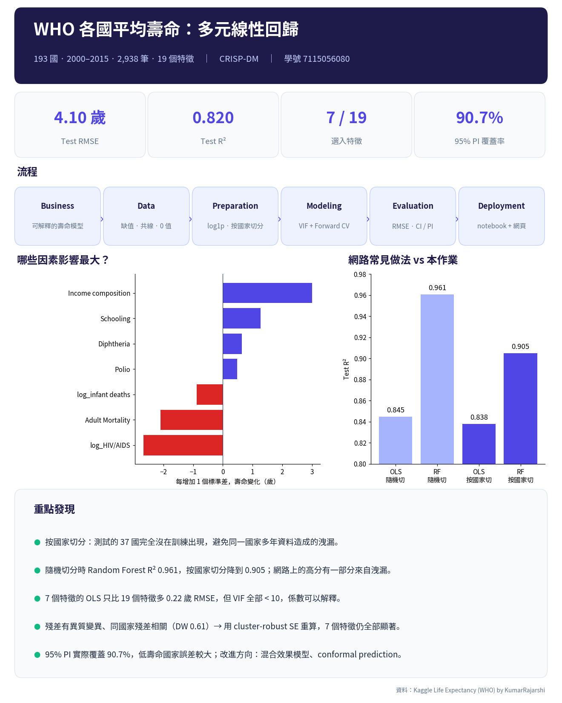

# HW2 Multiple Linear Regression

學號 7115056080

- 網頁 Demo：https://YOUR_GITHUB_ID.github.io/7115056080_hw2/
- Notebook：[7115056080_hw2.ipynb](7115056080_hw2.ipynb)



## 兩個問題（網頁右上角下拉選單切換）

| | Problem 1 | Problem 2 |
|---|---|---|
| 資料集 | [Life Expectancy (WHO), Kaggle](https://www.kaggle.com/datasets/kumarajarshi/life-expectancy-who) | [Car Price Prediction, Kaggle](https://www.kaggle.com/datasets/hellbuoy/car-price-prediction) |
| 規模 | 2,938 筆，19 個特徵 | 205 筆，24 個原始特徵（one-hot 後 43 個） |
| 目標 | Life expectancy | price（在 log(price) 上建模） |
| 切分 | 按國家切分 146 / 37 國，GroupKFold(5) | 隨機 80 / 20，KFold(5) |
| 最終模型 | VIF + Forward，k = 7 | Forward (CV)，k = 18 |
| Test RMSE / R² | 4.10 歲 / 0.820 | $2,226 / 0.873 |
| 95% PI 覆蓋率 | 90.7% | 90.2% |

Problem 1 在網頁預設設定下算出的係數、標準誤、RMSE 和預測區間，都和 notebook 一致。

這兩個都是 Kaggle Dataset，沒有 leaderboard，所以沒有名次。我改成拿公開解法回報的分數來對照：隨機切分時，Random Forest 的 R² 是 0.961，和公開解法的 0.96–0.97 一致；改成按國家切分後降到 0.905。

## 網頁功能

- 下拉選單切換兩個問題（加分 1）。
- 可以輸入任意 CSV 網址或上傳檔案（加分 2），例如 `https://raw.githubusercontent.com/Avik-Jain/100-Days-Of-ML-Code/master/datasets/50_Startups.csv`。程式會自動判斷欄位型態、排除 ID 和高基數欄位，類別欄做 one-hot，然後跑同一套流程。網址也可以直接放在參數裡：`index.html?data=<CSV 網址>`。
- CRISP-DM 六個階段的說明會依資料和模型自動更新。
- 6 種特徵選擇方法：VIF + Forward、Forward (CV)、RFE、Lasso path、Correlation filter、Exhaustive（p ≤ 12 才開放）。k 只用 CV 決定：取 CV RMSE 在最低值 1% 以內、特徵最少的 k。
- 結果包含 OLS 係數表（SE、t、p、95% CI、VIF）、預測圖（95% 信賴區間 + 預測區間）、Actual vs Predicted 圖、殘差圖、測試國家時間序列，以及回歸假設檢查（VIF、Jarque-Bera、Breusch-Pagan、Durbin-Watson、PI 覆蓋率）。
- Live Predictor：輸入原始數值後，即時顯示預測值和 95% PI，也可以直接帶入測試樣本。

所有計算都在瀏覽器裡用 JavaScript 完成，沒有後端。

## 檔案

```
index.html                  網頁（單一檔案，資料已內嵌）
7115056080_hw2.ipynb / .py  Problem 1 完整分析
7115056080_hw2_report.docx  報告
data/                       兩個資料集 CSV
figures/                    notebook 圖表、infographic.png
model/                      life_expectancy_ols.joblib
web_src/                    網頁原始碼與測試
```

## 部署到 GitHub Pages

```bash
git init && git add . && git commit -m "HW2 multiple linear regression"
git branch -M main
git remote add origin https://github.com/YOUR_GITHUB_ID/7115056080_hw2.git
git push -u origin main
```

推上去之後到 Settings → Pages，Source 選 `Deploy from a branch`、`main` / `(root)`。大約一分鐘後就能從上面的網址打開。

## 重新產生網頁 / 驗證

```bash
python3 web_src/build.py index.html     # 由 web_src 組合出 index.html
node web_src/test_who.js                # 檢查 JS 結果是否和 notebook 相同（k=7、RMSE 4.1035…）
node web_src/test_car.js log fwd        # Car Price：log 目標 + Forward
```

Car Price 的 JS 結果另外用 statsmodels 在相同的切分上驗證過：係數差小於 1e-4，F、BP、JB、DW 和預測區間都一致。

## 執行 notebook

```bash
pip install pandas numpy scikit-learn statsmodels matplotlib seaborn joblib
jupyter notebook 7115056080_hw2.ipynb
```
